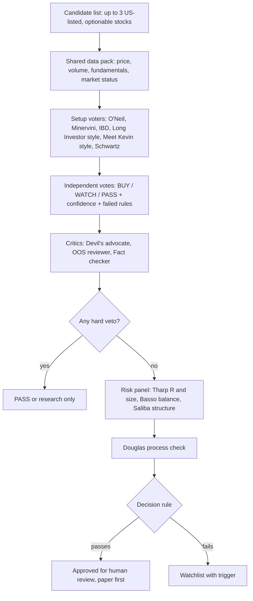

# Trader Persona Council

A research framework in which several "persona bots" review the same stock idea. Each bot is modeled on the publicly described method of a well-known trader or source. The bots vote independently, critics challenge the result, and a fixed rule produces the final decision.

> **Disclaimer.** This is an independent educational project and tribute. It is **not affiliated with, endorsed by, or reviewed by** any of the people or organizations named. Each persona is our own paraphrased interpretation of public books, lectures, interviews and posts, and it may be incomplete or wrong. No book text is reproduced beyond brief references. **Nothing here is financial advice.** This repository contains no trading code, broker integration or account data.

## Why we built it
A single method has blind spots. A growth-breakout rule set says nothing about position sizing. A psychology framework does not pick stocks. A macro view ignores the chart. Combining them in a structured debate:
- forces every idea through entry, risk, sizing, market context and psychology checks;
- makes the disagreement visible instead of hiding it in one score;
- lets a skeptic attack the idea before any money is involved.

## How the personas were built
1. **Sources:** for each persona we collected public material: books (studied through legally available summaries, interviews and narrations), recorded lectures and interviews, IBD educational videos, and public social posts for the two creator-style personas.
2. **Evidence tagging:** every rule in our internal notes was marked as verified against a source (with timestamp or link), from memory or summaries (needs checking), or unverified. Only rules with reasonable support were kept here.
3. **Rule extraction:** methods were turned into short, testable rules (thresholds, order of checks, what each persona avoids).
4. **Persona spec:** each folder has a `README.md` (sources, role, rules, output format) and a `prompt.md` (a persona prompt written from scratch).

## The council
| Persona | Main question it answers |
|---|---|
| [William O'Neil — CAN SLIM](william-oneil-canslim) | Is this a fundamentally strong leader breaking out properly? |
| [Mark Minervini — SEPA](mark-minervini-sepa) | Is it in Stage 2 with a tight, low-risk setup? |
| [IBD team](ibd-team) | What is the market status, and is the entry in the buy zone? |
| [Meet Kevin style](meet-kevin-style) | Does the macro chain support the trade? |
| [The Long Investor style](the-long-investor-style) | Is this a quality business at long-term weekly support? |
| [Tony Saliba](tony-saliba) | What is the best defined-risk options structure? |
| [Marty Schwartz](marty-schwartz) | Is the short-term trend green, and where is the "uncle point"? |
| [Van Tharp](van-tharp) | What is R, the expectancy, and the right size? |
| [Tom Basso](tom-basso) | Does the position fit portfolio risk and volatility balance? |
| [Mark Douglas](mark-douglas-trading-in-the-zone) | Is the process objective, and is the risk accepted in advance? |

### Critics (not traders)
- **Devil's advocate:** writes the strongest case *against* the idea.
- **Out-of-sample (OOS) reviewer:** asks whether the signal behind the idea held up on data it was not tuned on, after realistic costs (bid/ask). If not, the idea is research only.
- **Fact checker:** verifies every number cited by the personas against the input data.

## The joint brainstorm: the "3-stock committee"
The committee reviews a short list (typically 3 candidates) and works in rounds:



### Round by round
1. **Independent votes.** Each setup persona sees the same data and votes without seeing the others' votes, to avoid herding.
2. **Challenge.** Critics attack the majority view. Personas may change their vote once, and must state why.
3. **Risk panel.** For anything still alive: stop and R (Tharp), volatility-adjusted size (Basso), and optionally a defined-risk options structure (Saliba).
4. **Process check.** Douglas confirms the edge and the risk were defined before the decision, not after.

### Final decision rule (default)
- **Hard vetoes:** market in correction (IBD/O'Neil); no definable stop; failed OOS check; data error found by the fact checker.
- **Approve** only if there is no veto, at least 2/3 of setup voters say BUY or WATCH, at least 2 say BUY, and the risk panel gives a size within the per-trade risk limit.
- Otherwise: **watchlist** with an explicit trigger (e.g., "breakout above pivot on volume ≥ 50% above average").
- The output is a recommendation for a human. The council never places orders.

### Example committee output
```yaml
ticker: XYZ
votes: {oneil: BUY, minervini: WATCH, ibd: BUY, long_investor: PASS, meet_kevin: BUY, schwartz: BUY}
critics:
  devils_advocate: "Earnings in 6 days; base is only 5 weeks."
  oos_reviewer: "Pattern tested OOS: acceptable after costs."
  fact_check: OK
vetoes: none
risk: {stop: -7%, R_per_share: 3.10, risk_per_trade: 1%, structure: "call vertical, defined risk"}
process_check: PASS
decision: APPROVE_FOR_HUMAN_REVIEW
```

## Repository layout
```
README.md                      this file
<persona>/README.md            sources, role, rules, example output
<persona>/prompt.md            original persona prompt
LICENSE
```

## License
MIT for the text and prompts written here. Names of people and publications belong to their owners and are used only for identification.
